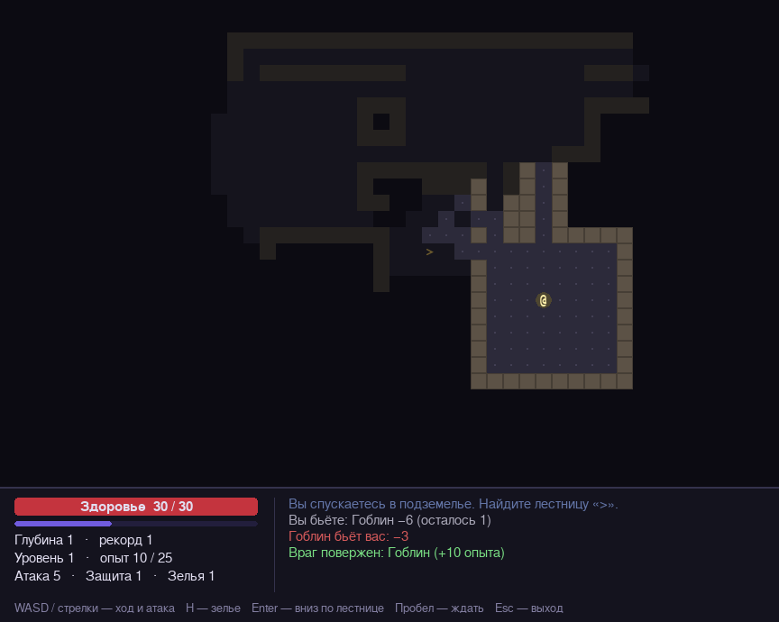

# Roguelike

Пошаговый roguelike на Python и Pygame. Каждый уровень подземелья генерируется заново, монстры видят и преследуют игрока, а с глубиной становятся сильнее.



## Возможности

- Процедурная генерация подземелий: комнаты и коридоры, каждый уровень новый
- Туман войны: видно только то, что в поле зрения, исследованные места запоминаются
- 6 видов монстров, на каждой глубине появляются новые, старые усиливаются
- Монстры замечают игрока, преследуют его кратчайшим путём и какое-то время помнят, потеряв из виду
- Предметы: зелья лечения, мечи, щиты, амулеты
- Опыт и уровни персонажа
- Воспроизводимые подземелья через `--seed`
- Управление работает и на русской раскладке

## Запуск

Нужен Python 3.8+.

```bash
pip install -r requirements.txt
python roguelike.py
python roguelike.py --seed 42     # одно и то же подземелье при каждом запуске
```

| Клавиша | Действие |
|---|---|
| Стрелки / WASD | Ход; шаг в монстра — атака |
| H | Выпить зелье |
| Enter | Спуститься по лестнице `>` |
| Пробел | Пропустить ход |
| R | Новая игра после гибели |
| Esc | Выход |

## Как устроено

**Логика отделена от отрисовки.** Класс `Game` не вызывает pygame ни разу: он принимает действия вида `('move', 1, 0)` и меняет состояние мира. `Renderer` только рисует это состояние. Поэтому всю игровую логику можно тестировать без окна.

**Генерация подземелья.** Случайные прямоугольные комнаты ставятся так, чтобы между ними оставалась стена. Каждая новая комната соединяется Г-образным коридором с предыдущей, поэтому всё подземелье гарантированно связно. Тест проверяет это на 25 разных зёрнах.

**Поле зрения.** Из позиции игрока выпускаются лучи (алгоритм Брезенхема) к каждой клетке на границе квадрата радиуса 8. Луч останавливается на первой стене. Затем подсвечиваются стены, соседние с видимым полом, — это убирает характерные «дыры» лучевого метода.

**Преследование: карта расстояний.** Вместо отдельного поиска пути для каждого монстра раз в ход строится одна карта расстояний от игрока обходом в ширину (BFS). Монстру достаточно шагнуть в соседнюю клетку с меньшим значением, чтобы идти кратчайшим путём. Сколько бы ни было монстров, BFS запускается один раз за ход.

**Данные отдельно от кода.** Виды монстров и предметов описаны неизменяемыми `dataclass`-шаблонами (`MonsterKind`, `ItemKind`). Чтобы добавить монстра, достаточно одной строки в таблице.

## Тесты

```bash
python -m unittest -v
```

15 тестов: связность подземелий, видимость через стены, бой, повышение уровня, движение монстров по карте расстояний и симуляция 5000 случайных ходов без ошибок.
